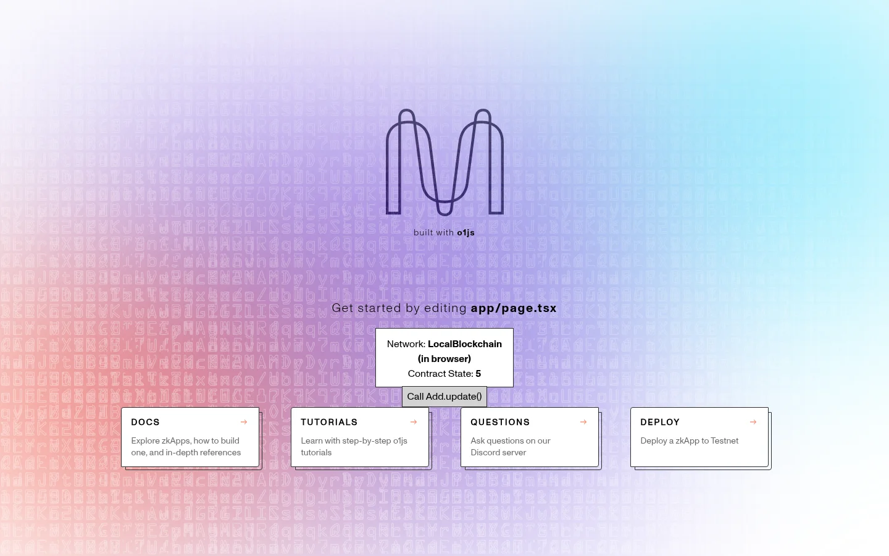

# Mina zkApp starter dApp

The smallest end-to-end Mina zkApp: an o1js smart contract plus a Next.js page that reads its state and calls it
from the browser. I used it as the hands-on companion to four intro talks on Mina zkApps that I gave in early
2025 at EPFL workshops run with the Blockchain Student Association (BSA), commissioned by the Mina Foundation.



## zkApps and o1js, from first principles

- **Smart contract:** a program that lives on a blockchain. Its state (here, one number) can change only by running
  its methods.
- **The usual approach (for example, Ethereum):** every node re-runs every contract call to check it. That is
  expensive, and every input is public.
- **The Mina approach:** you run the method yourself, in your browser. Then you send the chain a
  **zero-knowledge proof** (a zk-SNARK) that says "this method ran correctly and produced this new state".
  Nodes only check the proof, which is small and fast to verify no matter how much work the method did.
  Inputs you don't publish stay private.
- **zkApp:** Mina's name for this kind of proof-backed smart contract, together with the UI that calls it.
- **o1js:** the TypeScript library you write zkApps in. Its types (`Field`, `Bool`, `PublicKey`, ...) and methods
  compile to the circuit that the proof is about. That is why contract code looks like normal TypeScript, but it
  must stay deterministic and fixed-size.
- **Three steps per call:** execute locally, then `transaction.prove()`, then send. The chain then verifies the
  proof and updates the on-chain state.

## What the starter shows

| Part | File | What it does |
| --- | --- | --- |
| Contract | `contracts/src/Add.ts` | `Add` has one on-chain state field, `num`. `init()` sets it to 1, and `update()` adds 2. `getAndRequireEquals()` makes the proof valid only against the current on-chain value. |
| Tests | `contracts/src/Add.test.ts` | Jest tests that deploy `Add` on a `LocalBlockchain` (a simulated in-memory Mina ledger) and check 1, then 3. |
| UI | `ui/app/page.tsx` | Reads `num`, compiles the contract (which builds the proving key), then proves `update()` and sends it through the Auro browser wallet. It links to the transaction on MinaScan. |

The UI tries Mina devnet first. The original devnet deployment (`B62qnTDE...mtWe5`) no longer exists after devnet
resets, so the page falls back to an in-browser `LocalBlockchain`. That fallback deploys a fresh `Add` and calls it
with a built-in test account, so no wallet is needed. It skips proof generation (`proofsEnabled: false`) so a call
takes seconds. Add `?local=1` to the URL to force this mode.

## How to run

Requires Node 18 or later (tested on Node 22).

```sh
# contract: compile and test (about 5 s)
cd contracts
npm ci
npm run build
npm test            # 2 tests pass

# UI: imports the compiled contract from ../contracts/build
cd ../ui
npm ci
npm run dev         # http://localhost:3000, falls back to local mode if devnet has no Add contract
npm run build       # static export to ui/out
```

To use real devnet, deploy your own `Add` with the zkApp CLI (`zk config`, then `zk deploy`). Then put its address
in `zkAppAddress` in `ui/app/page.tsx` and install the [Auro wallet](https://www.aurowallet.com/).

## Context: the talks

- Format: four recorded intro talks for EPFL students (BSA workshops), Mina Foundation, Jan to Mar 2025.
- Content: what a zero-knowledge proof buys a smart contract, the o1js programming model, and this starter as the
  live demo. A follow-up tutorial built a commit-reveal coin-flip zkApp.
- The scaffold comes from the official `zkapp-cli` template. The only change since the workshops is the
  `LocalBlockchain` fallback, which keeps the demo runnable now that the devnet contract is gone.

## License

Apache-2.0 (see `contracts/LICENSE`), as in the zkApp CLI template.
